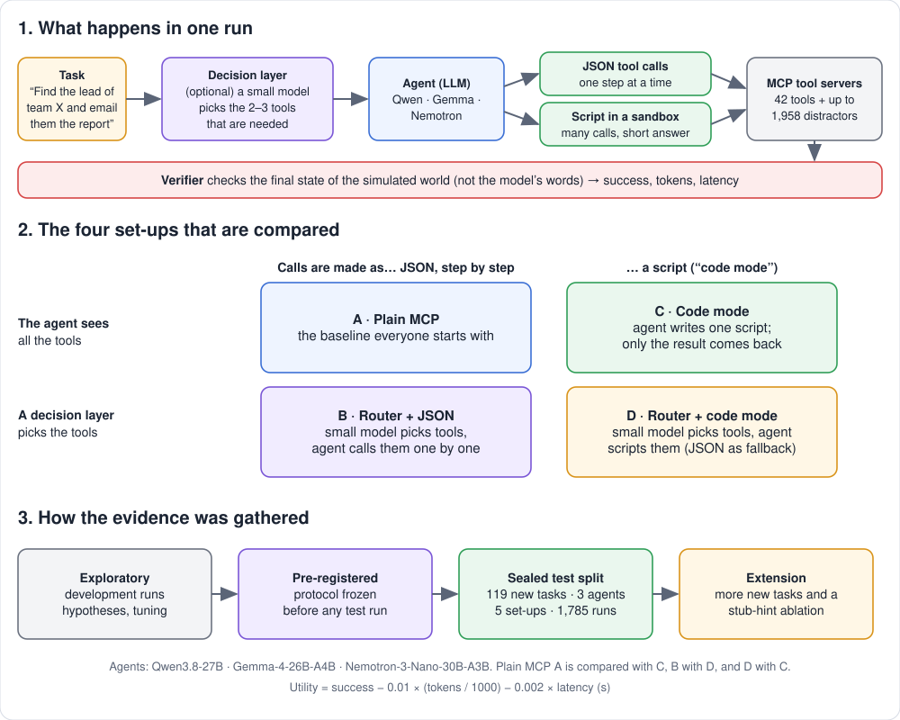

# MCP Decision Layer

**Code mode vs. decision layers in MCP gateways: a pre-registered study.**

AI agents that use many tools through the [Model Context Protocol (MCP)](https://modelcontextprotocol.io) pay for those tools twice: every tool description is put in the prompt, and every tool result is copied back through the model. Two fixes are popular:

* **Code mode.** The agent writes one short script against generated tool stubs. The script runs in a sandbox, chains the calls, and only a short answer returns to the model.
* **A decision layer.** A small model picks the few tools the task needs, so the agent never sees the whole catalog.

This repository contains the harness, the tasks, the raw run records and the analysis code for a controlled comparison of the two, using three open-weight agents, with a pre-registered evaluation on a sealed test split.



## The question

| | Hypothesis |
|---|---|
| H1 | Code mode (C) beats plain MCP (A) |
| H2 | A router with JSON calls (B) beats plain MCP (A) |
| H3 | A router with code mode (D) beats code mode alone (C) — the central hypothesis |
| H4 | A router with code mode (D) beats a router with JSON calls (B) |

Outcome measure: utility `U = success − 0.01 × tokens/1000 − 0.002 × latency_s`, where success is checked against the final state of a simulated world, not against what the model says.

## What was found (pre-registered test split, 119 tasks × 3 agents × 5 set-ups)

* **H1** is supported for Qwen3.8-27B and Nemotron-3-Nano; code mode also cuts tokens by 70–90 % for all three agents.
* **H3 is not confirmed** for any agent. The pattern seen during development (a router helps the weaker coders, not the strongest) is there in the point estimates but is statistically inconclusive.
* **H4** is supported for Qwen; the evidence is weaker for the other two once results are clustered by task family.
* Exploratory analyses (development seeds) suggest that telling the agent what each tool *returns* matters a lot, that choosing the call shape adds nothing, and that routers need a bounded fallback.

Everything above, with confidence intervals, corrections for multiple comparisons, robustness checks and limitations, is in the paper. The per-run records and the analysis outputs are in [`traces/confirmatory/`](traces/confirmatory).

## Pre-registration

The protocol is in [`docs/PREREG.md`](docs/PREREG.md). Its confirmatory part was committed before any run on the sealed test split, and the configuration was frozen at the git tag `confirmatory-freeze-v1`. Analyses added after the first confirmatory results (a task-family bootstrap, sensitivity to the utility weights, extra test instances, a stub-hint ablation) are specified in the same file under *Extension protocol* and are labelled as extensions.

## Repository layout

| Path | Contents |
|---|---|
| `worlds/` | the simulated MCP world (12 servers, 42 tools) and a catalog of real distractor tools |
| `tasks/` | programmatic task templates with reference solvers and verifiers |
| `gateway/` | the gateway: plain MCP, code mode with a sandbox, the decision layer, fallbacks |
| `bench/` | the runner, latency and utility reports, and the confirmatory analysis scripts |
| `security/` | prompt-injection payloads and the router-poisoning test |
| `training/` | code that builds the router's training records and fine-tunes it |
| `traces/` | run records and reports (development and confirmatory) |
| `docs/PREREG.md` | the pre-registration |

## Reproducing

```bash
python -m venv .venv && source .venv/bin/activate
pip install -r requirements.txt

# 1. Serve an agent behind an OpenAI-compatible API (vLLM, tensorfold, ...) and
#    point the SUT table at the top of bench/run.py at it. For the router, set
#    MDL_ROUTER_URL to a service exposing /v1/decide.

# 2. Run set-ups A, C and D on one world seed (development split, hinted stubs):
python bench/run.py --cfg A C D/mcprouter/code --sut qwen --salt dev --seeds 0 \
    --out traces/my_run.jsonl --no-think --stub-returns --fallback-policy full_code --theta 0.05

# 3. Re-run the confirmatory analysis on the released records:
python bench/confirm_analysis.py traces/confirmatory
python bench/confirm_robustness.py traces/confirmatory
```

The sealed split uses `--salt test`; the pre-registered flags are listed in `docs/PREREG.md`.

## Released models and data

* Router model and training data, and run traces: <https://huggingface.co/abhishek085>

## Limitations

The world is synthetic and the tools answer instantly; test tasks use the same template families as development tasks; there is one run per cell at temperature 0; and the agents are quantised, run without thinking. No real third-party MCP servers or external benchmarks are included. The paper discusses these in full.

## License

Apache-2.0 — see [`LICENSE`](LICENSE).
